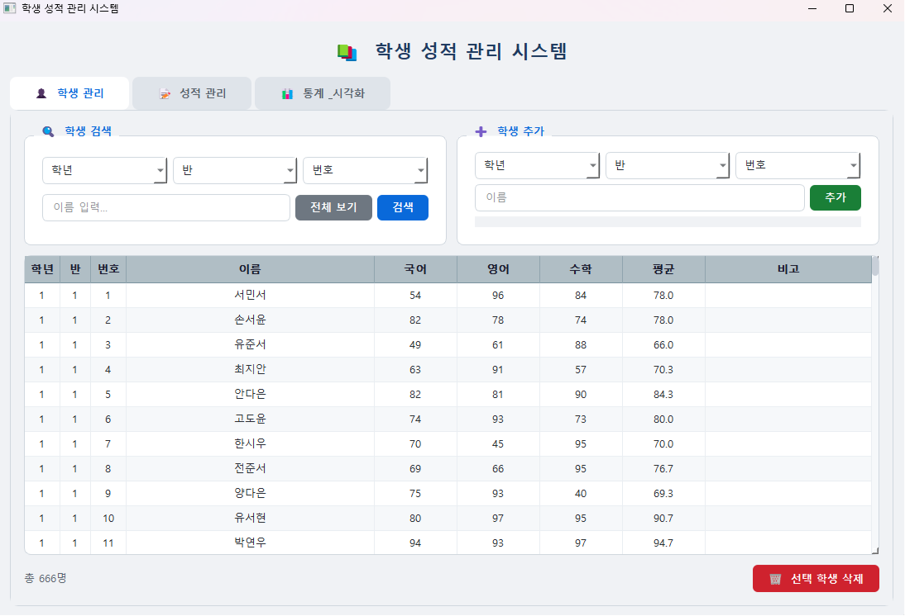
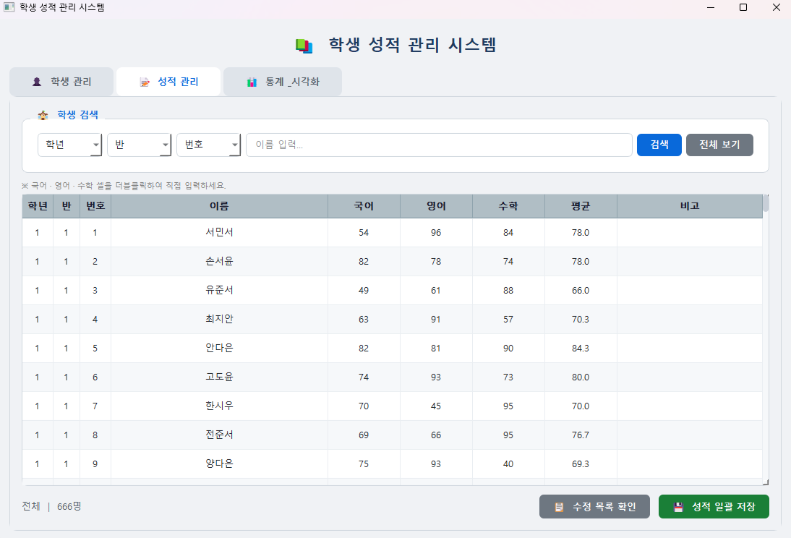
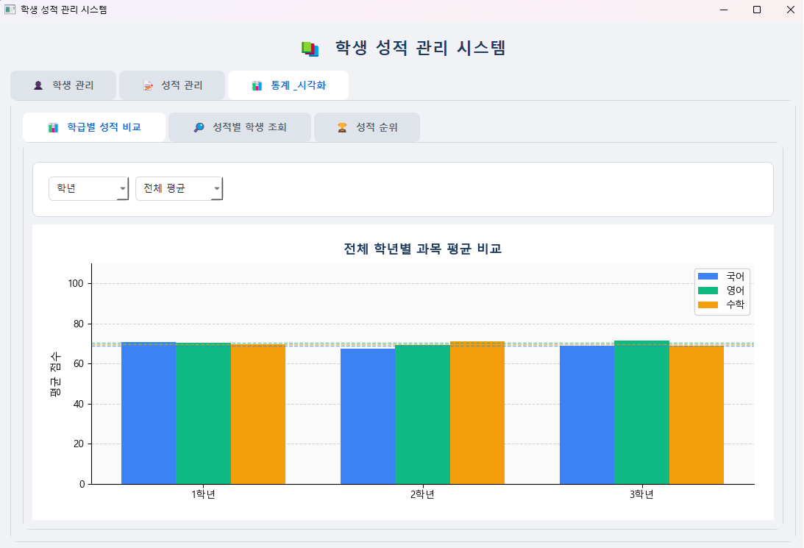
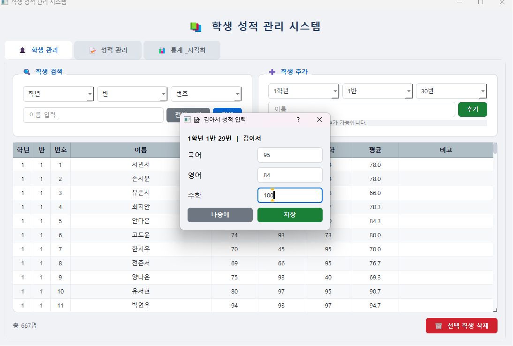
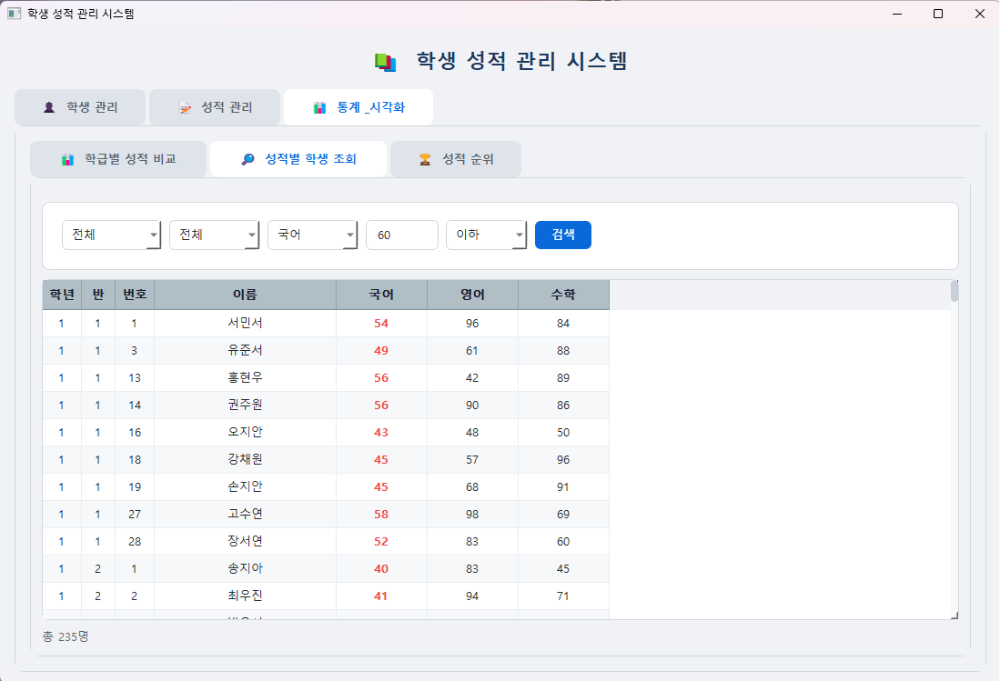
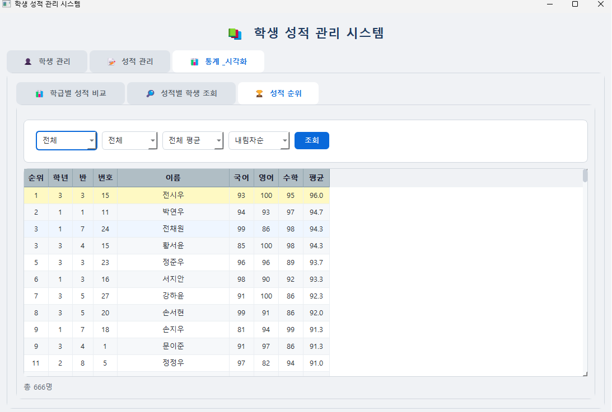
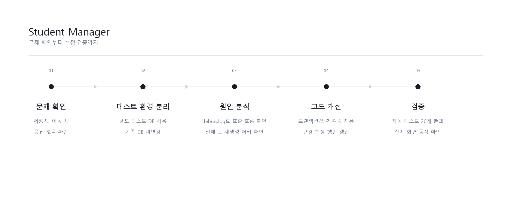

# Student Manager

## 핵심 구현

- **Python GUI 개발:** PyQt5의 버튼·표·탭 이벤트를 연결해 학생 관리 화면을 구현했습니다.
- **SQL CRUD와 데이터 무결성:** SQLite로 학생·성적 데이터를 저장하고, 성적 일괄 저장에는 트랜잭션과 롤백을 적용했습니다.
- **입력 검증과 오류 처리:** 필수 입력값과 0~100 점수 범위를 검사하고, 저장 실패 시 수정 내용을 유지합니다.
- **상태 관리:** 학생 키 `(학년, 반, 번호)`를 기준으로 저장 전 성적 수정 내용을 관리합니다.
- **문제 분석과 성능 개선:** 표 전체를 다시 만드는 처리로 인한 화면 멈춤을 로그로 확인하고, 변경된 학생 행만 갱신하도록 수정했습니다.
- **테스트:** 기존 DB와 분리한 테스트 DB로 저장·검색·정렬·롤백·탭 이동 시나리오를 검증했습니다.

## 프로젝트 소개

- **목적:** 학생 정보와 성적을 한곳에서 관리하고, 학급별 성적 현황을 비교하는 데스크톱 애플리케이션 개발
- **구현 범위:** 학생·성적 CRUD, 조건별 검색, 성적 순위, 평균 그래프
- **구현 중점:** 화면과 DB 처리 분리, 입력 검증, 저장 오류 복구, 화면 갱신 방식 개선
- **개발 기술:** Python · PyQt5 · SQLite · Matplotlib
- **개발 도구:** Visual Studio Code

## 사용 기술

| 기술 | 활용 |
| --- | --- |
| Python | 클래스별 역할 분리, 입력 검증, 데이터 처리 |
| PyQt5 | 신호·슬롯 기반 검색·편집·탭 이동 처리 |
| SQLite | 학생·성적 CRUD, 조건 검색, 트랜잭션 |
| Matplotlib | 학급별 과목 평균 그래프 |
| unittest | 별도 테스트 DB를 활용한 저장·오류 처리 검증 |

## Python·SQL 적용 근거

| 기초 개념 | 관련 코드 | 구현 내용 |
| --- | --- | --- |
| 클래스와 객체 | `DBManager`, `StudentTab`, `ScoreTab` | DB 처리와 화면별 기능을 클래스로 분리 |
| 함수 분리 | `views/`, `database/db_manager.py` | 검색, 저장, 입력 검증, 화면 갱신을 메서드 단위로 구성 |
| 이벤트 기반 처리 | PyQt5 신호·슬롯 | 버튼 클릭, 표 셀 수정, 탭 이동에 따라 검색·저장·안내 실행 |
| 딕셔너리 자료구조 | 성적 관리의 수정 목록 | `(학년, 반, 번호)`를 키로 하여 저장 전 수정 과목과 값을 관리 |
| 조건문·예외 처리 | 학생 추가·성적 저장 | 필수 입력, 점수 범위, 저장 실패를 검사하고 안내 |
| SQL CRUD | `DBManager` | 학생 추가·조회·수정·삭제와 조건 검색 수행 |
| 기본키 | `students` 테이블 | `grade`, `class_num`, `num` 조합으로 학생 식별 |
| 트랜잭션과 롤백 | `update_scores_batch()` | 여러 학생 성적 저장 중 오류가 발생하면 전체 변경 취소 |
| 테스트 | `tests/` | 저장, 검색, 정렬, 롤백, 탭 이동 시나리오를 테스트 DB로 검증 |

## 주요 기능

### 학생 관리

- 학년·반·번호 또는 이름 검색
- 학생 추가·삭제 및 비고 수정
- 필수 입력 누락·공백 이름 검사



### 성적 관리

- 국어·영어·수학 점수 편집 및 일괄 저장
- 0~100 정수 입력 검증 및 평균 계산
- 과목 점수·평균의 숫자 기준 정렬
- 검색 조건 변경 후에도 수정 내용 유지
- 미저장 상태에서 탭 이동·종료 시 저장 여부 확인



### 통계·시각화

- 선택 학년의 학급별 과목 평균 비교
- 학년·반·과목·점수 조건별 학생 조회
- 과목별 성적 순위 및 정렬 조건 선택



<details>
<summary>추가 화면 보기</summary>

#### 학생 추가 후 성적 입력



#### 조건별 학생 조회



#### 성적 순위



</details>

## 구현 흐름

### 화면과 DB 처리 분리

- 화면 클래스: 사용자 입력·이벤트 처리·조회 결과 표시
- `DBManager`: SQLite 연결·CRUD·통계 조회 담당
- `(학년, 반, 번호)` 복합 기본키로 학생 식별

```text
사용자 입력 → 입력 검증 → DB 저장·조회 → 표·그래프 갱신
```

### 성적 일괄 저장과 오류 복구

- 학생 키별 변경 내용을 보관해 조회 결과와 저장 대상 분리
- 저장 전 수정 목록 전체의 점수 유효성 검사
- 단일 트랜잭션으로 수정 과목과 평균 저장
- 오류 발생 시 전체 롤백, 수정 내용 유지
- 저장 성공 시 변경 목록 초기화 및 해당 학생 정보 반영

## 문제 해결



### 필수 입력 누락 차단

- **문제:** 학년·반 미선택 상태에서도 학생 추가 가능
- **개선:** 저장 전 학년·반·번호 선택 여부와 이름 검사
- **확인:** 누락 입력 차단 및 정상 입력 저장·조회 확인

### 일부 성적만 저장되는 문제 개선

- **문제:** 여러 학생 저장 중 오류 발생 시 일부 성적만 저장
- **개선:** 일괄 저장에 단일 트랜잭션 적용 및 실패 시 전체 롤백
- **확인:** 잘못된 점수·삭제된 학생 포함 시 기존 성적 유지

### 화면 멈춤 원인 분석과 갱신 방식 개선

- **문제:** 저장·탭 이동 중 전체 학생 표 재생성으로 응답 지연
- **분석:** `debug.log`에서 675명 × 9열의 표 항목 재생성 확인
- **개선:** 저장 후 전체 표 재생성 제거, 표시 중인 변경 학생 행만 갱신
- **확인:** 저장 후 학생 관리 탭 이동 및 변경 행 반영 확인

## 실행 방법

```powershell
git clone https://github.com/Jenny5789/student_manager.git
cd student_manager

python -m venv venv
.\venv\Scripts\Activate.ps1

python -m pip install -r requirements.txt
python main.py
```

- DB 위치: `database/student.db`
- 학생 테이블이 비어 있을 경우 초기 샘플 데이터 자동 생성

## 프로젝트 구조

```text
student_manager/
├── main.py                  # 앱 시작점
├── requirements.txt         # 실행 의존성
├── database/
│   └── db_manager.py        # DB 초기화·CRUD·통계 조회
├── views/
│   ├── main_window.py       # 탭 구성·화면 연결
│   ├── student_tab.py       # 학생 관리
│   ├── score_tab.py         # 성적 편집·저장
│   ├── stats_class_tab.py   # 학급별 평균 그래프
│   ├── stats_search_tab.py  # 조건별 조회
│   └── stats_ranking_tab.py # 성적 순위
├── tests/                   # 저장·검색·상태 관리 검증
└── images/                  # 화면 이미지
```
