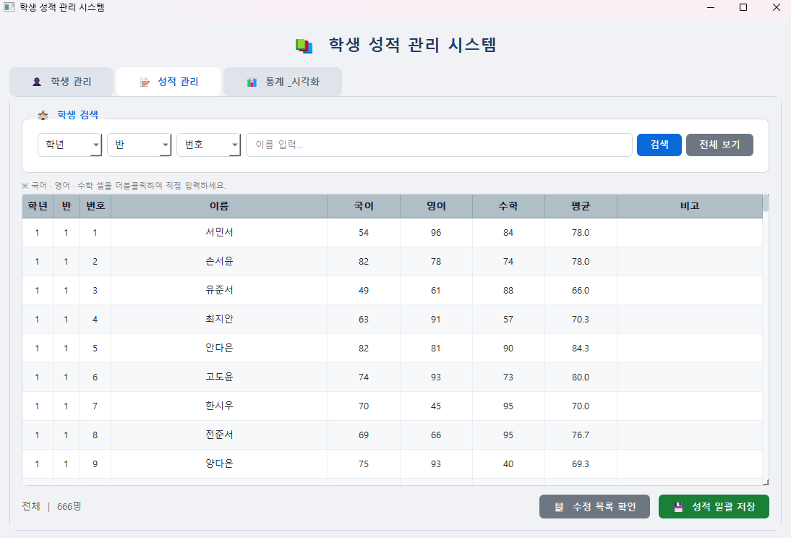
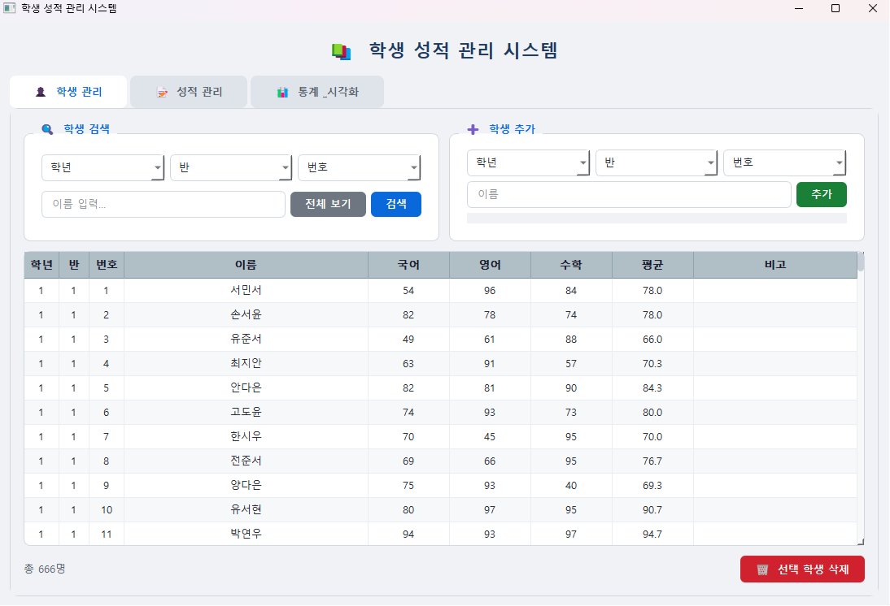
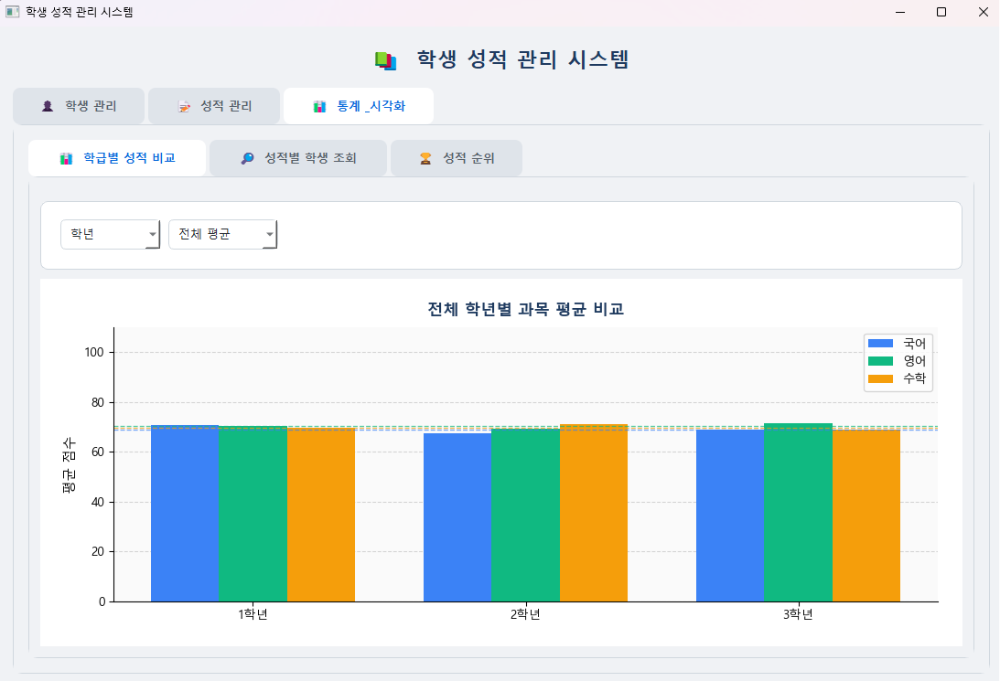
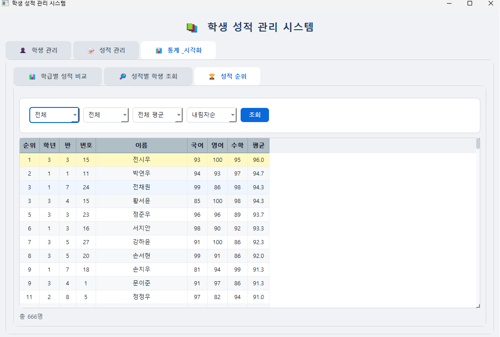

<div align="center">

# 학생 관리 프로그램

DB CRUD·트랜잭션·단위 테스트를 적용한 **PyQt5 데스크톱 앱**

`Python` · `PyQt5` · `SQLite` · `Matplotlib` · `unittest`



</div>

---

## 1. 프로젝트 개요

- **배경:** 학생·성적 정보를 엑셀 없이 한 화면에서 관리·통계·검색
- **목표:** 학생·성적 관리, 통계, 검색을 하나의 GUI 앱에서 제공
- **기간:** 2026.06.07 – 2026.06.20
- **규모:** 학생 675명 테스트 / 탭 6개 / 단위 테스트 포함

| 영역 | 기술 | 사용 이유 |
| --- | --- | --- |
| GUI | PyQt5 | 크로스플랫폼 데스크톱 위젯, Qt 시그널·슬롯 이벤트 처리 |
| 데이터베이스 | SQLite (Python 표준 라이브러리) | 서버 없이 파일 하나로 관리, 별도 설치 불필요 |
| 그래프 | Matplotlib + FigureCanvasQTAgg | PyQt5와 직접 연동, 학급별 평균 막대 그래프 |
| 테스트 | unittest (Python 표준 라이브러리) | 별도 패키지 없는 저장·검색·롤백 단위 테스트 |

---

## 2. 주요 화면

| 학생 관리 | 성적 관리 |
| --- | --- |
|  |  |
| ① 학생 추가·삭제·검색, 비고 수정 | ② 성적 편집·일괄 저장, 정렬 |

| 학급별 비교 | 성적 순위 |
| --- | --- |
|  |  |
| ③ 과목별 학급 평균 그래프 | ④ 과목별 순위와 정렬 |

---

## 3. 주요 기능

### 3-1. 학생 관리
- 학년·반·번호 또는 이름 검색, 학생 추가·삭제, 비고 수정
- 필수 입력 누락·공백 이름 저장 전 검사

### 3-2. 성적 관리
- 국어·영어·수학 점수 직접 편집, 0~100 정수 검증, 평균 자동 계산
- 점수·평균 기준 정렬, 미저장 상태에서 탭 이동·종료 시 저장 여부 확인
- 수정 내용을 `(학년, 반, 번호)` 키로 누적 → 검색 조건 변경 시에도 유지, 단일 트랜잭션 일괄 저장

<details>
<summary>코드: 수정 내용 누적과 일괄 저장·롤백</summary>

<br />

[views/score_tab.py](views/score_tab.py)

```python
key = (grade, class_num, num)
if key not in self._modified:
    self._modified[key] = {
        "name": self.table.item(row, 3).text(),
        "grade": grade, "class_num": class_num, "num": num
    }
self._modified[key][col_name] = item.text()   # 수정한 과목만 기록
```

[database/db_manager.py](database/db_manager.py)

```python
def update_scores_batch(self, changes):
    conn = self.get_connection()
    try:
        with conn:
            conn.execute("BEGIN IMMEDIATE")
            for key, fields in changes.items():
                row = conn.execute(
                    "SELECT korean,english,math FROM students "
                    "WHERE grade=? AND class_num=? AND num=?", key
                ).fetchone()
                if row is None:
                    raise ValueError(f"학생이 존재하지 않습니다: {key}")
                scores = [fields.get(subject, row[i]) for i, subject in
                          enumerate(("korean", "english", "math"))]
                if any(type(value) is not int or not 0 <= value <= 100
                       for value in scores):
                    raise ValueError("점수는 0~100 사이의 정수여야 합니다.")
                conn.execute(
                    "UPDATE students SET korean=?,english=?,math=?,average=? "
                    "WHERE grade=? AND class_num=? AND num=?",
                    (*scores, sum(scores) / 3, *key)
                )
    finally:
        conn.close()
```

</details>

### 3-3. 학급별 비교
- 선택 학년의 학급별 과목 평균 Matplotlib 막대 그래프

### 3-4. 조건별 조회·성적 순위
- 학년·반·과목·점수 조건으로 학생 조회
- 과목별 성적 순위와 정렬 조건 선택

---

## 4. 문제 해결 경험

### 1) 학년·반 미선택 시 학생 추가

- **문제:** 학년·반을 고르지 않아도 학생이 추가됨
- **원인 분석:** 저장 전 필수 입력 검증 없음
- **해결:** 저장 전 학년·반·번호·이름 존재 여부 검사 추가
- **결과:** 필수 입력 누락 시 경고 후 저장 차단

### 2) 오류 시 일부 성적만 저장

- **문제:** 여러 학생 성적 저장 중 오류 발생 시 일부만 반영
- **원인 분석:** 성적마다 개별 `UPDATE` 호출, 트랜잭션 없음
- **해결:** 단일 트랜잭션으로 묶어 오류 시 전체 롤백
- **결과:** 원자성 보장, 중간 실패 시 DB 상태 유지

### 3) 대용량에서 화면 멈춤

- **문제:** 675명 데이터에서 저장·탭 이동 시 화면이 수 초간 멈춤
- **원인 분석:** `debug.log`로 확인, 저장·이동마다 9열 × 675행 전체 표 재생성
- **해결:** 전체 표 재생성 제거, 변경된 학생 행만 갱신
- **결과:** 반응 지연 제거

---

## 5. 한계와 개선 방향

- **단일 사용자:** 동시 접근 처리 없음, 멀티유저 환경으로 확장 시 충돌 처리 필요
- **로컬 파일 DB:** `student.db`를 여러 PC에서 공유 불가, PostgreSQL 등 서버 DB로 대체 가능
- **고정된 과목 구성:** 국어·영어·수학 3과목 하드코딩, 과목을 설정 파일로 분리 가능
- **UI 테마 없음:** 기본 Qt 스타일만 적용, QSS로 커스텀 테마 추가 가능

---

<details>
<summary><b>실행 방법과 파일 구조</b></summary>

<br />

Python 3.x.

```powershell
git clone https://github.com/Jenny5789/student_manager.git
cd student_manager

python -m venv venv
.\venv\Scripts\Activate.ps1

python -m pip install -r requirements.txt
python main.py
```

- DB 위치: `database/student.db`
- 학생 테이블이 비어 있으면 샘플 데이터 자동 생성

```
student_manager/
├── main.py                  # 앱 시작점
├── requirements.txt
├── database/
│   └── db_manager.py        # DB 초기화·CRUD·통계 조회
├── views/
│   ├── main_window.py       # 탭 구성·화면 연결
│   ├── student_tab.py       # 학생 관리
│   ├── score_tab.py         # 성적 편집·저장
│   ├── stats_class_tab.py   # 학급별 평균 그래프
│   ├── stats_search_tab.py  # 조건별 조회
│   └── stats_ranking_tab.py # 성적 순위
├── tests/                   # 저장·검색·상태 관리 검증
└── images/
```

</details>

---

## 6. 프로젝트를 통해 얻은 경험

- **MVC 분리:** `views/`는 표시만, `database/`는 DB 처리만 담당해 단위 테스트 작성 용이
- **트랜잭션 관리:** 일괄 저장을 단일 트랜잭션으로 묶어 원자성 보장, 롤백 로직 직접 구현
- **성능 개선:** `debug.log`로 병목 위치를 찾고 전체 재생성 → 행 단위 갱신으로 개선
